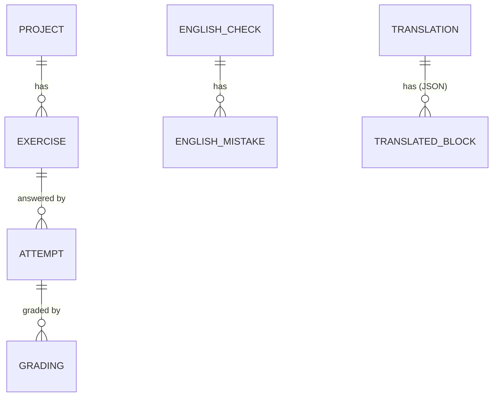

# Data model: review and proposal

Status: proposal. The database and the code will follow this model later. Every name here is new on purpose. Current
names appear only in section 2 and in the mapping table.

## 1. Domain in one paragraph

Claude Translate is a local, single-user app for an English learner. It has three features. **Translate** turns English
into Vietnamese (or back). Each run is saved as a **translation**: the source text, the output split into **translated
blocks** (one heading, paragraph or list item next to its translation), and how the model ran. **Practice** holds
**projects** (for example one day of study). A project has ordered **exercises** of seven types: rewrite, translation,
correction, essay, choice, gap fill and flashcard. The learner submits **attempts** (an answer to one exercise). Claude
**grades** an attempt in the background. The learner rates a flashcard attempt instead. **English log** is a Claude Code
hook. It saves each English message the user types as an **English check**, with the **English mistakes** Claude finds
in it. Unsent answers live in the browser as **drafts**.

## 2. Problems with the current model

**Practice**

1. **An attempt and its grading are one row** (`features/practice/server/store-schema.ts:37-57`). The answer never
   changes; the grading does. Nothing stops `status = 'graded'` with no result, or `'failed'` with one. A regrade
   overwrites the last run and keeps its old `model` and `grading_ms` (`store.ts:265`).
2. **The same fact is stored two or three times**, so copies drift and every write must update all of them:
   - model, effort and duration in columns *and* in `result_json` (`store.ts:577-584`, `api.ts:140-147`);
   - `attempts.type` copies the snapshot's type (`store-schema.ts:44-45`);
   - `attempts.grader` follows from the type (`answers.ts:18-20`);
   - `attempts.summary` is display text (`store.ts:13`, `answers.ts:54`);
   - `projects.last_activity_at` is fixed by hand on every write and move (`store-schema.ts:20`, `store.ts:200`,
     `store.ts:244`).
3. **Attempts copy the exercise key and project** (`store-schema.ts:39-41`), and rename and move must rewrite them
   (`store.ts:240-242`). They exist only because deleting an exercise sets `exercise_id` to NULL.
4. **One type hides three exercises.** `rewrite` is a rewrite, a translation or a correction, chosen by two flags
   (`api.ts:14-16`, `text.ts:12-14`). Bad mixes are allowed, such as `prefill` with `source_lang: 'vi'`.
5. **The import format is the stored format.** Hidden defaults (`min_words` 250, `prefill` false, `correct` false:
   `api.ts:14-44`) must be known by every reader. `FillGap.answer` is `string | string[]` (`api.ts:56`).
6. **Unions cannot be narrowed.** `content` depends on a sibling `type` (`api.ts:88-93`), and an answer has no `type`
   (`api.ts:128-135`). The code needs casts (`answers.ts:28`, `text.ts:19`).
7. **One concept, many names.** The given text is `text`, `input_text` or `original`. The task is `instruction`, `prompt`
   or `question`. The reason is `why`, `note` or `explanation`. A model answer is `reference` or `sample` (`api.ts:9-75`,
   `history-store.ts:17`, `hook.ts:46`). Rating `'unknown'` means "did not know" (`api.ts:126`).
8. **Empty is said two ways.** `description` is `''` (`store-schema.ts:16`); `topic` is `NULL` (`store-schema.ts:28`).
9. **Unchecked strings.** `attempts.effort` has no CHECK (`store-schema.ts:52`). An interrupted grading is recorded only
   as free text (`store.ts:275`).

**Translate history**

10. **A failure has no reason.** The error kind and message are not saved (`server/server.ts:249-254`). A run with no
    output is not saved at all (`server/server.ts:247`).
11. **Effort is not one enum.** 3 values in the type (`shared/api.ts:5`), 5 in the database (`history-store.ts:26`),
    `string` in the API (`shared/api.ts:99`).
12. **Every model run has its own shape.** `served_model_id` vs `model`, `thinking_duration_ms` vs `thinking_ms`, and
    three status vocabularies (`shared/api.ts:7`, `api.ts:159`, `hook.ts:49`).

**English log and browser**

13. **One status mixes progress and result.** `'clean'` and `'checked'` both mean "finished" (`hook.ts:49`). No mistakes
    is NULL or `[]` (`hook.ts:186-190`). Mistakes are JSON, but the goal is to count them by category (`hook.ts:17`).
14. **Times and versions are not uniform.** Drafts use epoch milliseconds and have no version (`drafts.ts:41`). Some rows
    have `updated_at`, some do not. The practice file has its version in its name *and* in `PRAGMA user_version`
    (`server/server.ts:27`).

## 3. Proposed model

### 3.1 Conventions

- **Casing.** TypeScript and HTTP JSON use camelCase fields and PascalCase types. SQL uses snake_case. The mapping is
  mechanical: `createdAt` ↔ `created_at`. JSON stored in a column keeps the TypeScript (camelCase) keys.
- **Names.** Entities are singular (`Exercise`); tables are plural (`exercises`). Enum values are lowercase snake_case
  (`'gap_fill'`). `type` is used only as the tag of a tagged union.
- **Suffixes.** `Id`: a reference to an entity, by its full name (`englishCheckId`); an ID from another system names
  that system (`claudeSessionId`). `At`: a `Timestamp`; a nullable `xxxAt` replaces a boolean (`archivedAt`). `Ms`:
  milliseconds. `Markdown`: Markdown text; any other text is plain. `is`: a boolean. Plural: an array.
- **IDs.** Every entity has an integer `id` that never changes and is never reused. A project and an exercise also have
  a `key` (`a-z 0-9 -`, 1 to 64 characters) for URLs and import files. A key changes only by an explicit rename.
- **Times.** Every entity has `createdAt` and `updatedAt`. `updatedAt` changes on every write.
- **Empty.** An absent value is `null`, never `''`. An empty list is `[]`, never `null`.
- **Derived data is not stored.** The full list is in key rule 9.

### 3.2 Glossary

| Term | Means |
|---|---|
| `sourceText` | the text the user gives, or is given, to work on |
| `instruction` | what the learner must do ("Rewrite in the passive") |
| `question` | the line the learner answers in a choice exercise |
| `constraints` | short rules the grader checks (the learner sees them too) |
| `modelAnswer` | a good answer by the exercise author; the learner sees it after grading |
| `hint` | help shown before answering |
| `explanationMarkdown` | why something is right or wrong |
| `wrongText` / `correctText` | a mistake and its fix |

### 3.3 Shared types and the model run

```ts
type Timestamp = string;               // ISO 8601 UTC with ms: "2026-10-21T08:30:00.000Z"
type Language = 'en' | 'vi';
type Effort = 'low' | 'medium' | 'high' | 'xhigh' | 'max';   // every CLI value; the UI offers a subset
type ModelId = string;                 // "claude-sonnet-5-5"
type TextLength = 'sentence' | 'paragraph' | 'multi_paragraph';   // sets the answer's size limit

type RunStatus = 'running' | 'succeeded' | 'failed' | 'cancelled';

type RunErrorCode =
  | 'start_failed' | 'no_response' | 'stalled' | 'output_limit' | 'exited' | 'claude_error'   // from the CLI
  | 'empty_reply'                      // the model answered with no text
  | 'no_check_block'                   // English check: the reply had no check block
  | 'invalid_reply'                    // Practice generation: the reply was not the JSON asked for, or too few exercises passed
  | 'interrupted';                     // the server stopped during the run

// One call to a model. Grading, Translation and EnglishCheck each hold one, as `run`.
interface ModelRun {
  status: RunStatus;
  requestedModelId: ModelId | null;    // null only for EnglishCheck: the app does not choose
  servedModelId: ModelId | null;       // differs from requested after a fallback
  effort: Effort | null;               // null only for EnglishCheck
  thinkingText: string | null;         // null when the model did not think
  thinkingMs: number | null;
  errorCode: RunErrorCode | null;
  errorMessage: string | null;
  startedAt: Timestamp;
  finishedAt: Timestamp | null;
}
```

Run rules, the same for every run:

| `status` | `finishedAt` | `errorCode`, `errorMessage` | the entity's output |
|---|---|---|---|
| `running` | null | null | none yet, or partial |
| `succeeded` | set | null | complete |
| `failed`, `cancelled` | set | set for `failed` only | none, or partial |

- The row is saved when the run starts and updated when it ends.
- When the server starts, every `running` row becomes `failed` with `interrupted`.

### 3.4 Practice

**Project**: a group of exercises, usually one day of study.

```ts
interface Project {
  id: number;
  key: string;                         // unique: "m1-day-02"
  name: string;                        // 1 to 80 characters
  description: string | null;          // up to 500 characters
  archivedAt: Timestamp | null;        // set: hidden from the default list
  createdAt: Timestamp;
  updatedAt: Timestamp;
}
```

**Exercise**: one task in a project. `version` starts at 1 and goes up by 1 when topic, tags or content really change.
Writing the same content again is no change.

```ts
interface Exercise {
  id: number;
  projectId: number;
  key: string;                         // unique inside its project
  position: number;                    // 1, 2, 3...
  topic: string | null;
  tags: string[];
  content: ExerciseContent;
  version: number;
  createdAt: Timestamp;
  updatedAt: Timestamp;
}

type ExerciseContent =
  | RewriteContent | TranslationContent | CorrectionContent | EssayContent
  | ChoiceContent | GapFillContent | FlashcardContent;

type ExerciseType = ExerciseContent['type'];

interface RewriteContent {             // say the same text another way
  type: 'rewrite';
  instruction: string;
  sourceText: string;
  length: TextLength;
  constraints: string[];               // up to 3
  modelAnswer: string | null;
}

interface TranslationContent {
  type: 'translation';
  instruction: string;
  sourceText: string;
  sourceLanguage: Language;
  targetLanguage: Language;
  length: TextLength;
  constraints: string[];               // up to 3
  modelAnswer: string | null;
}

interface CorrectionContent {          // the answer box starts with sourceText
  type: 'correction';
  instruction: string;
  sourceText: string;
  length: TextLength;
  plantedMistakes: PlantedMistake[];   // may be []
  constraints: string[];               // up to 3
  modelAnswer: string | null;
}

interface PlantedMistake {
  wrongText: string;
  correctText: string;
  explanationMarkdown: string | null;
}

interface EssayContent {               // e.g. IELTS Task 2
  type: 'essay';
  instruction: string;
  minWords: number;
  suggestedMinutes: number | null;     // a guide, never a limit
  constraints: string[];               // up to 3
  modelAnswer: string | null;
}

interface ChoiceContent {
  type: 'choice';
  instruction: string | null;
  question: string;
  context: string | null;              // a text the question is about
  options: ChoiceOption[];             // 2 to 6
}

interface ChoiceOption {
  text: string;
  isCorrect: boolean;
  explanationMarkdown: string;
}

interface GapFillContent {
  type: 'gap_fill';
  instruction: string | null;
  textWithGaps: string;                // "If more people {{1}} buses..."
  gaps: Gap[];
}

interface Gap {
  acceptedAnswers: string[];
  hint: string | null;
  explanationMarkdown: string | null;
}

interface FlashcardContent {
  type: 'flashcard';
  front: string;
  back: string;
  hint: string | null;
  example: string | null;              // an example sentence
  explanationMarkdown: string | null;
}
```

**Attempt**: one answer to one exercise. It never changes; delete is its only write. The snapshot is a copy on purpose:
an old attempt shows the exercise exactly as the learner saw it.

```ts
interface Attempt {
  id: number;
  exerciseId: number;
  exerciseVersion: number;
  exerciseSnapshot: ExerciseSnapshot;
  answer: Answer;
  timeSpentMs: number | null;          // from opening the exercise to Submit
  createdAt: Timestamp;                // when it was submitted
  updatedAt: Timestamp;
}

interface ExerciseSnapshot {
  topic: string | null;
  tags: string[];
  content: ExerciseContent;
}

type Answer = TextAnswer | ChoiceAnswer | GapFillAnswer | FlashcardAnswer;

interface TextAnswer {
  type: 'rewrite' | 'translation' | 'correction' | 'essay';
  text: string;
}

interface ChoiceAnswer {
  type: 'choice';
  chosenOptionIndexes: number[];       // sorted, no repeats
}

interface GapFillAnswer {
  type: 'gap_fill';
  gapAnswers: string[];
}

type FlashcardRating = 'didnt_know' | 'almost' | 'knew';

interface FlashcardAnswer {
  type: 'flashcard';
  rating: FlashcardRating;
}
```

**Grading**: one AI grading of one attempt.

```ts
interface Grading {
  id: number;
  attemptId: number;
  run: ModelRun;
  feedbackMarkdown: string | null;     // the grader's reply: the output
  createdAt: Timestamp;
  updatedAt: Timestamp;
}
```

### 3.5 Translate

**Translation**: one translate run.

```ts
interface Translation {
  id: number;
  sourceLanguage: Language;
  targetLanguage: Language;
  sourceFormat: 'plain_text' | 'markdown';   // 'markdown' also repairs broken layout
  sourceText: string;                  // exactly what was pasted
  blocks: TranslatedBlock[];           // the output
  textOutsideBlocks: string | null;    // reply text the model put in no block
  run: ModelRun;
  createdAt: Timestamp;
  updatedAt: Timestamp;
}

interface TranslatedBlock {
  blockType: 'heading' | 'paragraph' | 'list_item' | 'table' | 'code' | 'quote' | 'other';
  level: number;                       // heading or list depth; 0 when none
  marker: string | null;               // list marker: "-", "1."
  sourceText: string;                  // with 'markdown', the repaired text
  translatedText: string;
}
```

### 3.6 English log

**EnglishCheck**: one message the user typed, checked by Claude. **EnglishMistake**: one mistake found in it.

```ts
interface EnglishCheck {
  id: number;
  claudeSessionId: string;
  workingDirectory: string | null;
  sourceText: string;                  // the user's own words, without pasted text or code
  correctedText: string | null;        // the output; null when there are no mistakes
  run: ModelRun;
  createdAt: Timestamp;
  updatedAt: Timestamp;
}

type MistakeCategory = 'article' | 'singular_plural' | 'subject_verb_agreement' | 'verb_tense' | 'verb_form'
  | 'word_form' | 'word_choice' | 'collocation' | 'preposition' | 'pronoun' | 'sentence_structure' | 'run_on'
  | 'punctuation' | 'spelling' | 'linking' | 'register' | 'other';

interface EnglishMistake {
  id: number;
  englishCheckId: number;
  position: number;                    // 1, 2, 3... in the check
  wrongText: string;
  correctText: string;
  category: MistakeCategory;
  createdAt: Timestamp;
  updatedAt: Timestamp;
}
```

### 3.7 Browser

**Draft**: an unsent answer, in `localStorage`. It is removed when the server has the attempt.

```ts
interface Draft {
  schemaVersion: 1;
  exerciseId: number;
  exerciseVersion: number;             // warn if the exercise changed since
  answer: Answer;
  createdAt: Timestamp;
  updatedAt: Timestamp;
}
```

### 3.8 Relationships



### 3.9 Key rules

1. `attempt.answer.type` equals `attempt.exerciseSnapshot.content.type`.
2. `sourceLanguage` differs from `targetLanguage`.
3. Correction: each `wrongText` appears exactly once in `sourceText`.
4. Choice: at least one option is correct. With exactly one, the answer has exactly one index.
5. Gap fill: `textWithGaps` has the markers `{{1}}` to `{{n}}`, in order, with `n = gaps.length`. Each gap has at least
   one accepted answer. The answer has exactly `n` items.
6. A flashcard attempt has no grading: its rating is the result. Every other attempt gets a grading when it is created.
7. A regrade is allowed at any time and adds a new grading. At most one grading per attempt is `running`. The result
   shown is the latest grading (highest `id`).
8. An exercise or project with attempts is deleted only when the caller asks "with attempts"; its attempts go with it.
   So `attempt.exerciseId` is always set.
9. Derived, never stored:
   - an exercise is done = it has a flashcard attempt, or an attempt with a `succeeded` grading;
   - a project's last activity = the newest `createdAt` of its attempts;
   - counts, the list label ("Rewrite, sentence"), the preview and the history line ("Graded", "Almost");
   - is fallback = `servedModelId !== requestedModelId`;
   - an English check is clean = `succeeded` with no mistakes;
   - a run's duration = `finishedAt - startedAt`.

## 4. Storage shape

Three SQLite files, one per feature, because the English log hook runs outside the server.

- Every table is `STRICT`. IDs are `INTEGER PRIMARY KEY AUTOINCREMENT`.
- Every enum column has `CHECK (... IN (...))`. Every time column has a format check, such as
  `CHECK (created_at GLOB '[0-9][0-9][0-9][0-9]-[0-9][0-9]-[0-9][0-9]T*Z')`.
- A JSON column ends in `_json` and has `CHECK (json_valid(...))`.
- `run` becomes `run_*` columns (`run_status`, `run_started_at`...), with CHECKs for the run rules and an index on
  `run_status`.
- Indexes are named `<table>_by_<columns>`.
- The schema version is `PRAGMA user_version` only; file names have no version.

| File | Table | Keys and indexes |
|---|---|---|
| `data/practice.sqlite` | `projects` | `UNIQUE (key)` |
| | `exercises` | `project_id → projects ON DELETE CASCADE`; `UNIQUE (project_id, key)`; index `(project_id, position)` |
| | `attempts` | `exercise_id → exercises ON DELETE CASCADE`, NOT NULL; index `(exercise_id, id)` |
| | `gradings` | `attempt_id → attempts ON DELETE CASCADE`; index `(attempt_id, id)`; `UNIQUE (attempt_id) WHERE run_status = 'running'` |
| | `generations` (schema 4) | `project_id → projects ON DELETE SET NULL`; `translation_id` names a Translate row, no foreign key; indexes `(translation_id, id)`, `(run_status)`; `UNIQUE (translation_id) WHERE run_status = 'running'`. See [practice-from-translation-design.md](practice-from-translation-design.md) §3 |
| `data/translate.sqlite` | `translations` | index `(created_at)` |
| `data/english-log.sqlite` | `english_checks` | index `(claude_session_id, id)` |
| | `english_mistakes` | `english_check_id → english_checks ON DELETE CASCADE`; index `(category)` |

JSON on purpose:

- `exercises.content_json`, `attempts.exercise_snapshot_json`, `attempts.answer_json`: the shape depends on the type,
  and they are read whole. `exercises.type` copies `content.type` so lists can filter by type;
  `CHECK (type = content_json ->> '$.type')` keeps them equal.
- `exercises.tags_json`: filter with `json_each`, fast enough for a few thousand exercises.
- `translations.blocks_json`: blocks never change and are never queried alone.

English mistakes are a table, because the point of the log is to count them by category.

Outside the database:

- **Import file**: its own contract, `format: 4`. It may keep friendly optional fields; the importer fills every
  default, so stored content has none. The importer still reads format 3 (section 5).
- **Draft**: key `practice.draft.{exerciseId}`. A draft with an unknown `schemaVersion` is dropped.

## 5. Mapping from current to proposed

| Current | Proposed | Change |
|---|---|---|
| snake_case fields in TypeScript | camelCase in TypeScript, snake_case in SQL | mechanical rename |
| `projects.description = ''` | `null` | |
| `projects.last_activity_at` | removed | computed |
| `exercises.type` + `content_json` | `content`, tagged by `content.type` | `type` moves into the content |
| `rewrite` with `source_lang: 'vi'` | `translation` | `sourceLanguage 'vi'`, `targetLanguage 'en'` |
| `rewrite` with `prefill: true` | `correction` | `mistakes` → `plantedMistakes` |
| `write` | `essay` | `prompt` → `instruction`; `minutes` → `suggestedMinutes`; missing `min_words` → `250` |
| `reference`, `sample` | `modelAnswer` | one field |
| `text` (rewrite), `text` (fill) | `sourceText`, `textWithGaps` | |
| `length: 'essay'` | `'multi_paragraph'` | |
| `constraints` (rewrite only) | `constraints` on every text exercise | missing → `[]` |
| `mistakes[].wrong`, `.right`, `.note` | `wrongText`, `correctText`, `explanationMarkdown` | |
| `options[].correct`, `.why` | `isCorrect`, `explanationMarkdown` | missing `correct` → `false` |
| `fill`, `gaps[].answer`, `.why` | `gap_fill`, `acceptedAnswers`, `explanationMarkdown` | a string becomes a one-item list |
| `flashcard.explanation` | `explanationMarkdown` | |
| `attempts.submitted_at`, `writing_ms` | `createdAt`, `timeSpentMs` | |
| answer `{ chosen }`, `{ gaps }`, `{ rating }` | `chosenOptionIndexes`, `gapAnswers`, `rating` | add `type`; `unknown` → `didnt_know`, `known` → `knew` |
| `attempts.project_id`, `exercise_key`, `type`, `grader`, `summary` | removed | from the exercise or snapshot, or computed |
| `attempts.exercise_id` (nullable) | NOT NULL | none are NULL today; the migration asserts it |
| `attempts.status`, `result_json`, `model`, `effort`, `grading_ms`, `error`, `graded_at` | one `gradings` row per AI attempt | `graded` → `succeeded`; `result.text` → `feedbackMarkdown`; `finishedAt = graded_at`; `startedAt = graded_at − grading_ms`; both model IDs = `model` |
| `result_json` of a flashcard | removed | the rating is in the answer |
| `translations.outcome` | `run.status` | `done` → `succeeded`, `error` → `failed` |
| `input_text`, `mode` | `sourceText`, `sourceFormat` | `translate` → `plain_text`, `translate_markdown` → `markdown` |
| `duration_ms`, `thinking_duration_ms`, model IDs, `effort` | `run.*` | `finishedAt = startedAt + duration_ms` |
| `pairs_json`: `pair_type`, `translation_text`, `marker = ''` | `blocks_json`: `blockType`, `translatedText`, `marker = null` | |
| `unpaired_text = ''` | `textOutsideBlocks = null` | |
| `messages`: `original`, `corrected`, `session_id`, `cwd = ''` | `english_checks`: `sourceText`, `correctedText`, `claudeSessionId`, `workingDirectory = null` | |
| `messages.status` | `run.status` | `checked`, `clean` → `succeeded`; `parse_failed` → `failed` + `no_check_block`; `pending` → `running` |
| `messages.errors_json` | `english_mistakes` rows | one row per item |
| draft `{ type, answer, saved_at }` | `Draft` | add `schemaVersion`, `exerciseVersion`, `createdAt`; epoch ms → ISO |
| `practice-v2.sqlite`, `history.sqlite` | `practice.sqlite`, `translate.sqlite` | rename once, after a backup |

Old rows: `updatedAt = createdAt`. An old grading error about the server stopping becomes `interrupted`; any other old
error becomes `claude_error`. Old failed translations get `claude_error` with the message "Unknown (saved before error
details were kept)."

## 6. Decisions

The owner decided these. The rule for each is in 3.9 or 3.2.

1. **Delete with attempts only on purpose** (rule 8). Attempts then always have an exercise, so they copy nothing from it.
2. **Regrade at any time** (rule 7). You can compare models and keep every result.
3. **Plain integer IDs.** One local database needs nothing more; keys already give a portable identity for import and
   export.
4. **`modelAnswer` is always shown after grading** (glossary). One field, one rule; grader-only guidance goes in
   `constraints`.
5. **Every explanation is Markdown** (`explanationMarkdown`). One rule for all explanations.
